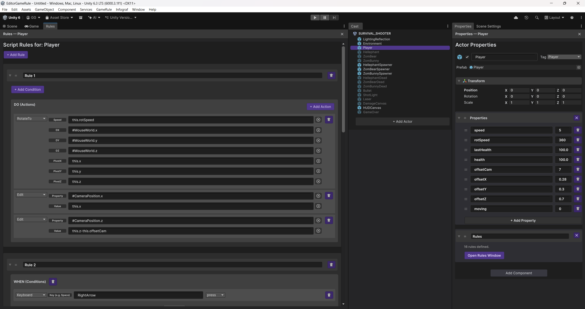

# GameRule Studio

GameRule Studio is a no-code visual authoring environment integrated into Unity. Built on the GameRule architecture and domain-specific language (DSL), it allows users to define game behavior through actors, properties, and reactive `when-do` rules without manually writing JSON descriptors or gameplay C# code.

This repository contains the Unity implementation of GameRule Studio and three example games used to demonstrate its functionality: **Survival Shooter**, **Tanks**, and **John Lemon's Haunted Jaunt**.

## Requirements and Setup

The implementation was developed and evaluated using **Unity 6.3 LTS (6000.3.1f1)**.

1. Download or clone this repository.
2. Open **Unity Hub** and select **Add project from disk**.
3. Select the repository folder containing `Assets`, `Packages`, and `ProjectSettings`.
4. Open the project in Unity.

## Opening the Editor

In the Unity menu bar, select **GameRule > Editor** to open the four GameRule Studio panels:

- **Rules**
- **Cast**
- **Properties**
- **Scene Settings**

The suggested workspace arranges Rules alongside Unity's Scene and Game views on the left, Cast in the center, and Properties and Scene Settings on the right. The panels can be docked and rearranged within Unity.

*Suggested arrangement of the GameRule Studio panels alongside Unity's Scene and Game views.*

## Editor Panels

| Panel | Description |
|---|---|
| **Cast** | Lists the actors in the current GameRule project. Selecting an actor determines which actor is displayed in Rules and Properties. |
| **Rules** | Displays and allows editing the selected actor's conditional `when-do` and unconditional `do` rules. |
| **Properties** | Displays and allows editing the selected actor's configuration and local properties. |
| **Scene Settings** | Configures scene-wide settings and global variables. |

GameRule Studio uses Unity's standard **Scene** view to inspect and edit the scene, **Game** view to display gameplay, and **Play** button to run or stop the game.

## Opening and Playing the Example Games

To load one of the three included example games:

1. In Unity, select **GameRule > Action > Open Project**.
2. Choose one of the following project assets located in the root `Assets` folder:
   - `SURVIVAL_SHOOTER.asset`
   - `TANKS.asset`
   - `JOHN_LEMON.asset`
3. Once the project is loaded, its actors will appear in the **Cast** panel.
4. Select any actor in Cast to inspect its behavior in **Rules** and its configuration in **Properties**.
5. Press Unity's **Play** button to start the game. Use the **Game** view to interact with it.
6. Press **Play** again to stop the game.

## Example Games and Controls

### 1. Survival Shooter

A survival game in which the player moves around the environment, faces enemies, and shoots to survive.

**Project file:** `Assets/SURVIVAL_SHOOTER.asset`

**Controls:**
- **Arrow keys:** Move the player.
- **Left mouse button:** Shoot.

The game demonstrates rule-based player movement, shooting, enemy behavior, and interactions between actors.

### 2. Tanks

A two-player tank combat game featuring movement, rotation, projectiles, and collisions. Each player controls a tank and attempts to defeat the opponent.

**Project file:** `Assets/TANKS.asset`

**Player 1 controls:**
- **W / A / S / D:** Move and rotate the tank.
- **Space:** Fire.

**Player 2 controls:**
- **Arrow keys:** Move and rotate the tank.
- **Enter:** Fire.

The game demonstrates multi-actor interaction, movement, projectile spawning, collisions, and rule-based combat behavior.

### 3. John Lemon's Haunted Jaunt

A navigation and avoidance game in which John Lemon explores a haunted environment while trying to avoid hostile characters and reach the goal.

**Project file:** `Assets/JOHN_LEMON.asset`

**Controls:**
- **Arrow keys:** Move John Lemon.

The game demonstrates character movement, navigation, collision detection, and rule-based interactions with other actors.

## Publications and Further Information

A detailed description of GameRule Studio, its visual interface, architecture, and evaluation is provided in the accompanying research article:

**GameRule Studio: A Visual No-Code Environment for Rule-Based Multi-Agent Systems in Video Games.** *Computers & Graphics*.

The final bibliographic reference and article link will be added once the paper is published.

GameRule Studio builds on the previously published GameRule architecture:

Montaña-Miranda, N., Chover, M., & Marín-Lora, C. (2026). GameRule: A Multi-Agent Architecture for Game Behavior Specification. *Multimedia Systems*, 32, 564.

https://doi.org/10.1007/s00530-026-02629-8
